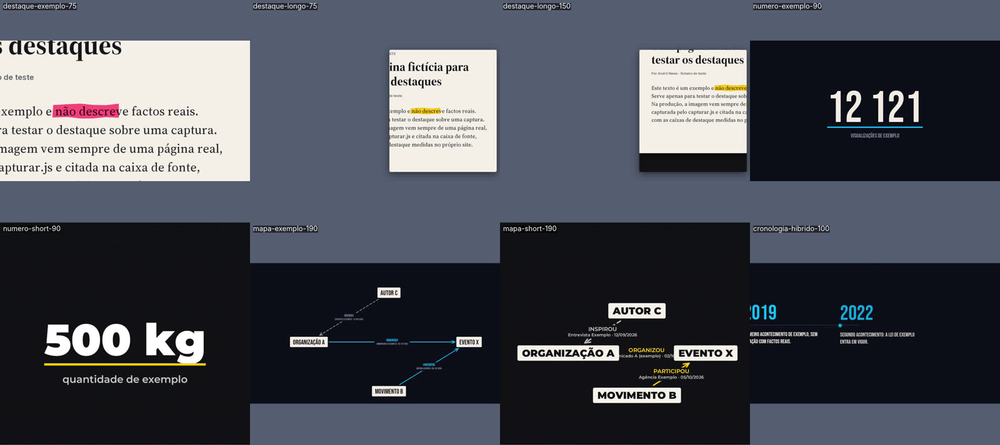

# Andr3 Motion · inserts em Remotion + Skia, sem CSS

Skills para um agente (Claude Code, Codex, Antigravity, Cursor…) fazer os inserts de motion do **Andr3 News**: destaques sobre capturas reais, números-chave, mapas de relações e cronologias, com um perfil por linha de produção (Shorts, longos, docs dark, docs híbridos). Tudo desenhado em **Skia** (canvas na GPU), nada de HTML/CSS, para fugir ao visual de "página web animada" e de template de IA.

Fork de [liamrjohnston/remotion-motion-graphics-skill](https://github.com/liamrjohnston/remotion-motion-graphics-skill) (MIT). Do original ficam o método (intake, gate bloqueante, crítico independente, câmara num só mundo, proibição de glow); sai tudo o que era HTML/CSS e o estilo de promo de SaaS.



Todos os exemplos usam dados fictícios e foram renderizados a partir do template, sem uma linha de CSS.

## Perfis (um por linha de produção)

| Perfil | Linha | Sai (`--scale=2`) | Fontes | Cores |
|---|---|---|---|---|
| `short` | Shorts (`fcp-shorts-noticias`) | painel 2160×1920 | Montserrat Black / SemiBold | `#FFD400`, `#E10600` |
| `longo` | Longos (`fcp-longos-noticias`) | 3840×2160, PiP com alfa | Montserrat | `#FFD400`, `#E10600` |
| `dark` | Docs dark (`fcp-doc-motion`) | 3840×2160 | Bebas Neue + Caveat Bold | `#18C8FF`, `#FF2D78` |
| `hibrido` | Docs híbridos (`_kit_hibrido`) | 3840×2160 | Bebas Neue + Caveat Bold | `#18C8FF`, `#FF2D78` |

25p por defeito (`"fps": 30` nos dados se a câmara estiver a 30p). A fonte de cada insert vai na lane de fonte do Final Cut.

## As 4 skills

| Skill | Para |
|---|---|
| [`andr3-motion`](skills/andr3-motion/SKILL.md) | Núcleo: intake, regras, motor Skia, template, gate e entrega. **Lê sempre primeiro.** |
| [`andr3-destaques`](skills/andr3-destaques/SKILL.md) | Marcador sobre a captura real de uma página (notícia, Diário da República, comunicado) |
| [`andr3-mapas`](skills/andr3-mapas/SKILL.md) | Números-chave, mapas de relações com arestas provadas, cronologias |
| [`andr3-camara`](skills/andr3-camara/SKILL.md) | Câmara contínua num só mundo; compor cenas novas (ex.: corroboração com 2 fontes) |

## Instalar

```bash
npx skills add Andr3Pereira/remotion-motion-graphics-skill
```

Ou, para criar logo um projeto de inserts pronto a usar:

```bash
bash install.sh <pasta-destino>
```

## Usar

```bash
cd <pasta-destino>
npm run exemplo:pagina                       # captura fictícia de teste
npx remotion studio src/index.ts             # pré-visualizar
G=<skill-andr3-motion>/scripts/andr3-gate.mjs
node $G dados dados/destaque-exemplo.json && node $G lint .
npx remotion render src/index.ts Destaque out/destaque.mp4 --props=dados/destaque-exemplo.json --scale=2 --muted
node $G qa out/destaque.mp4 --perfil dark
```

## Sem CSS, a sério

O gate `lint` chumba `style={...}`, `className`, folhas `.css`, Tailwind, `@keyframes`, elementos DOM (`div`, `img`…), `AbsoluteFill`, cores fora de `tokens.ts`, gradientes radiais e brilhos, sombras coloridas, travessões e brasileirismos. A única coisa que toca no DOM é o `<SkiaCanvas>` da própria biblioteca.

## Licenças

Código: MIT (ver `LICENSE`, inclui o aviso do projeto original). Fontes em `skills/andr3-motion/template/public/fonts`: SIL Open Font License 1.1 (ver `OFL.txt` na mesma pasta).
